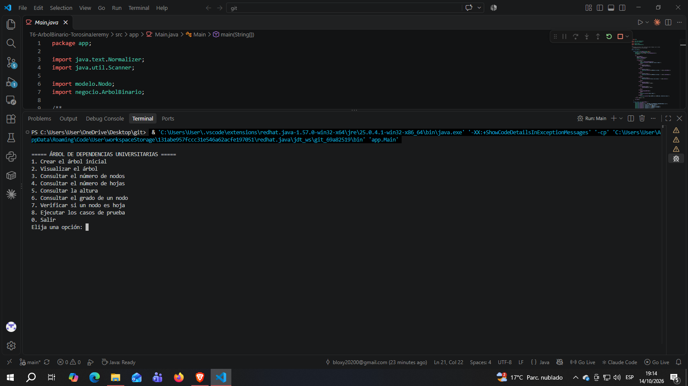
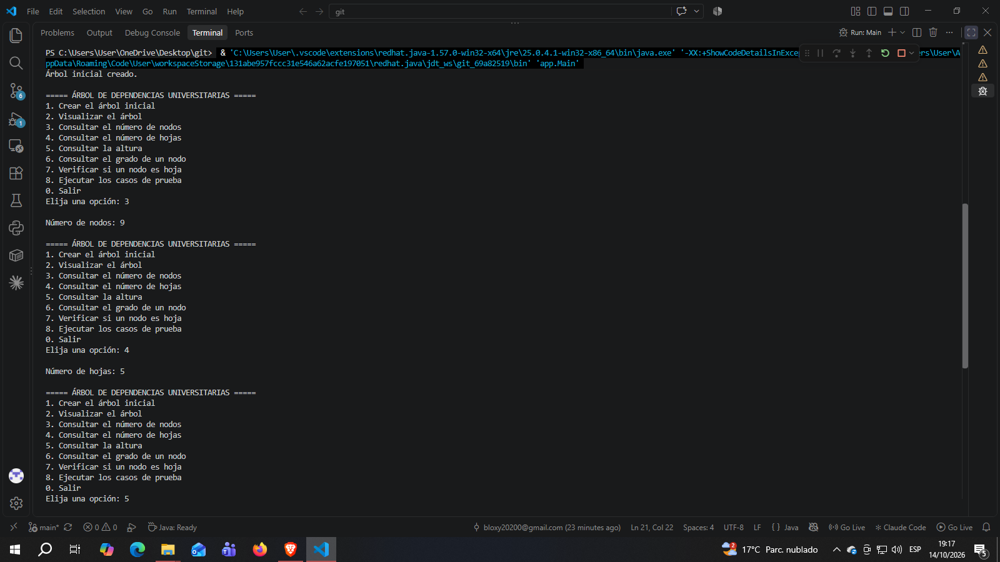
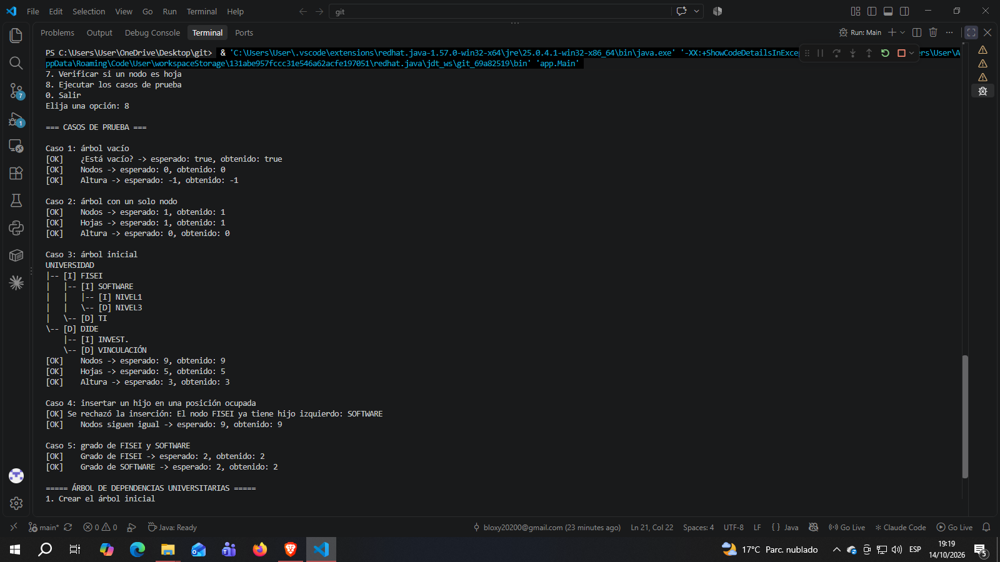

# T6 – Árbol Binario en Java

**Asignatura:** Estructura de Datos
**Nivel:** Tercero B – Software
**Facultad:** Ingeniería en Sistemas, Electrónica e Industrial – Universidad Técnica de Ambato
**Estudiante:** Jeremy Torosina
**Herramientas:** Java, Visual Studio Code y GitHub

---

## 1. Problema

La Universidad necesita un programa que represente la organización de sus dependencias académicas como un **árbol binario**. Cada nodo guarda el nombre de una dependencia y puede tener **como máximo dos hijos** (izquierdo y derecho).

El programa debe permitir construir el árbol, mostrarlo en consola y analizarlo: contar nodos y hojas, calcular la altura y consultar el grado de un nodo.

## 2. Estructura del árbol

```
             UNIVERSIDAD
             /         \
       FISEI             DIDE
       /   \             /   \
   SOFTWARE  TI     INVEST.  VINCULACIÓN
    /   \
  NIVEL1 NIVEL3
```

| Dato | Valor | Cómo se obtiene |
|---|---|---|
| Nodos | 9 | UNIVERSIDAD, FISEI, DIDE, SOFTWARE, TI, INVEST., VINCULACIÓN, NIVEL1, NIVEL3 |
| Hojas | 5 | TI, INVEST., VINCULACIÓN, NIVEL1, NIVEL3 |
| Altura | 3 aristas | UNIVERSIDAD → FISEI → SOFTWARE → NIVEL1 |

## 3. Organización del proyecto

```
T6-ArbolBinario-TorosinaJeremy/
├── src/
│   ├── modelo/
│   │   └── Nodo.java            -> clase genérica Nodo<T>
│   ├── negocio/
│   │   └── ArbolBinario.java    -> operaciones del árbol
│   └── app/
│       └── Main.java            -> menú interactivo y casos de prueba
├── capturas/                    -> capturas de pantalla de la ejecución
├── .gitignore
└── README.md
```

- **Nodo<T>:** guarda el dato y las referencias al hijo izquierdo y derecho. Tiene `esHoja()`, `grado()`, getters y setters.
- **ArbolBinario<T>:** `crearRaiz`, `agregarIzquierdo`, `agregarDerecho`, `contarNodos`, `contarHojas`, `altura`, `esVacio` y `mostrarArbol`. Además tiene `buscar`, que se usa para encontrar un nodo por su nombre en las consultas del menú.
- **Main:** menú con `Scanner` y los casos de prueba.

### Decisiones importantes

- **Recursividad:** `contarNodos`, `contarHojas` y `altura` se calculan de forma recursiva, como pide la práctica.
- **Altura en aristas:** el árbol vacío tiene altura `-1` y un árbol con un solo nodo tiene altura `0`.
- **Posición ocupada:** si se intenta agregar un hijo donde ya hay uno, se lanza una excepción con un mensaje claro y el árbol no cambia.
- **Restricciones:** no se usa `TreeSet`, `TreeMap`, `PriorityQueue`, `NavigableSet` ni `NavigableMap`.

## 4. Instrucciones de ejecución

**Requisito:** tener instalado el JDK 8 o superior (`java -version` y `javac -version` para comprobarlo).

Desde la carpeta del proyecto:

```bash
# 1. Compilar
javac -encoding UTF-8 -d out src/modelo/Nodo.java src/negocio/ArbolBinario.java src/app/Main.java

# 2. Ejecutar
java -cp out app.Main
```

> **Nota (Windows):** si en la consola las tildes se ven raras (por ejemplo en `VINCULACIÓN`), ejecuta primero `chcp 65001` o usa `java -Dfile.encoding=UTF-8 -cp out app.Main`.

También se puede abrir la carpeta en Visual Studio Code con el *Extension Pack for Java* y ejecutar `Main.java` con el botón **Run**.

## 5. Uso del menú

```
===== ÁRBOL DE DEPENDENCIAS UNIVERSITARIAS =====
1. Crear el árbol inicial
2. Visualizar el árbol
3. Consultar el número de nodos
4. Consultar el número de hojas
5. Consultar la altura
6. Consultar el grado de un nodo
7. Verificar si un nodo es hoja
8. Ejecutar los casos de prueba
0. Salir
```

Primero hay que usar la opción **1** para crear el árbol. En las opciones 6 y 7 se escribe el nombre del nodo (por ejemplo `FISEI` o `software`; no importan las mayúsculas ni las tildes).

## 6. Resultados

### Visualización del árbol (opción 2)

`[I]` indica hijo izquierdo y `[D]` hijo derecho.

```
UNIVERSIDAD
|-- [I] FISEI
|   |-- [I] SOFTWARE
|   |   |-- [I] NIVEL1
|   |   \-- [D] NIVEL3
|   \-- [D] TI
\-- [D] DIDE
    |-- [I] INVEST.
    \-- [D] VINCULACIÓN
```

### Consultas (opciones 3 a 7)

```
Número de nodos: 9
Número de hojas: 5
Altura (en aristas): 3
El grado de FISEI es: 2
El grado de SOFTWARE es: 2
TI SÍ es una hoja.
```

### Casos de prueba obligatorios (opción 8)

| # | Caso | Resultado esperado | Resultado obtenido |
|---|---|---|---|
| 1 | Árbol vacío | 0 nodos, altura -1 | 0 nodos, altura -1 |
| 2 | Árbol con un solo nodo | 1 nodo, 1 hoja, altura 0 | 1 nodo, 1 hoja, altura 0 |
| 3 | Árbol inicial | 9 nodos, 5 hojas, altura 3 | 9 nodos, 5 hojas, altura 3 |
| 4 | Insertar un hijo en una posición ocupada | Se rechaza la inserción | `El nodo FISEI ya tiene hijo izquierdo: SOFTWARE` |
| 5 | Grado de FISEI y SOFTWARE | 2 y 2 | 2 y 2 |

Salida completa de la opción 8:

```
=== CASOS DE PRUEBA ===

Caso 1: árbol vacío
[OK]    ¿Está vacío? -> esperado: true, obtenido: true
[OK]    Nodos -> esperado: 0, obtenido: 0
[OK]    Altura -> esperado: -1, obtenido: -1

Caso 2: árbol con un solo nodo
[OK]    Nodos -> esperado: 1, obtenido: 1
[OK]    Hojas -> esperado: 1, obtenido: 1
[OK]    Altura -> esperado: 0, obtenido: 0

Caso 3: árbol inicial
(se muestra el árbol de la sección anterior)
[OK]    Nodos -> esperado: 9, obtenido: 9
[OK]    Hojas -> esperado: 5, obtenido: 5
[OK]    Altura -> esperado: 3, obtenido: 3

Caso 4: insertar un hijo en una posición ocupada
[OK] Se rechazó la inserción: El nodo FISEI ya tiene hijo izquierdo: SOFTWARE
[OK]    Nodos siguen igual -> esperado: 9, obtenido: 9

Caso 5: grado de FISEI y SOFTWARE
[OK]    Grado de FISEI -> esperado: 2, obtenido: 2
[OK]    Grado de SOFTWARE -> esperado: 2, obtenido: 2
```

## 7. Capturas de pantalla






